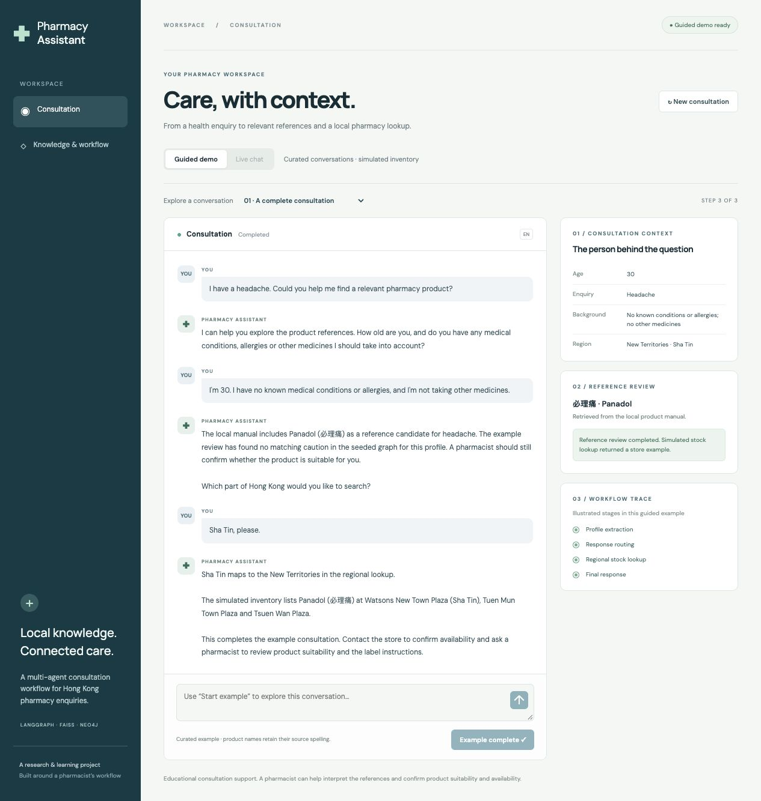
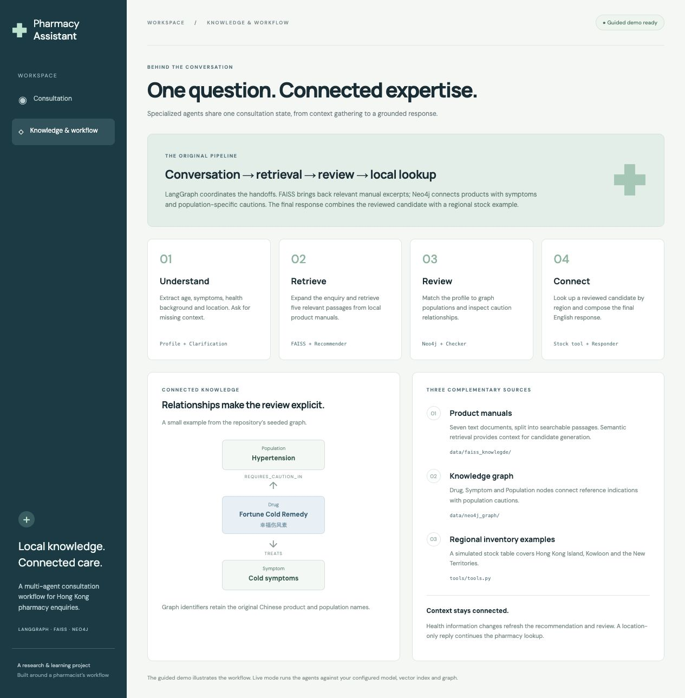
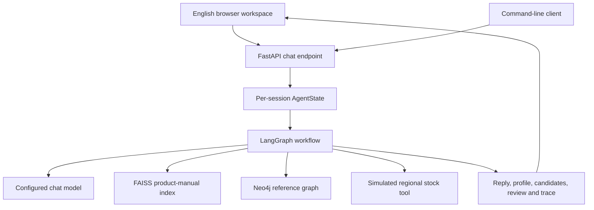
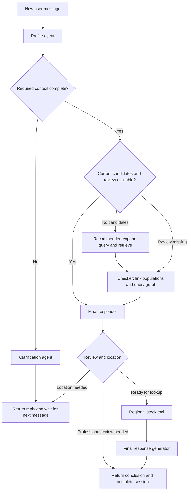
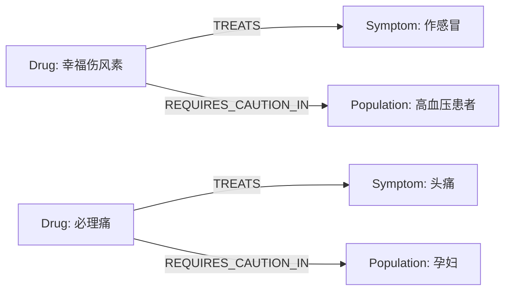
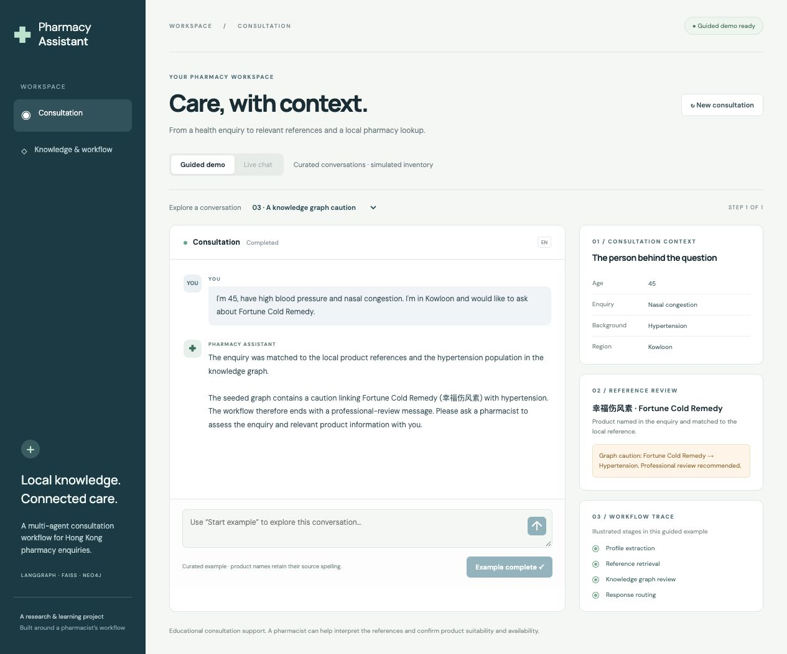

# Pharmacy Assistant · Multi-Agent Consultation Workspace

An English-language pharmacy enquiry workspace built around **LangGraph, retrieval-augmented generation, and a Neo4j knowledge graph**. The project turns a short question into a structured conversation: understand the person’s context, retrieve relevant product references, review population-specific cautions, and look up a product in a simulated Hong Kong pharmacy inventory.

The application brings the original specialized agents into a browser interface. Readers can follow three curated examples immediately, or connect a language model and the local knowledge sources to run the same workflow through live chat.



## Project background and business context

A pharmacy enquiry often starts with an incomplete description: “I have a headache,” “I am looking for a cold remedy,” or “Where can I find this product?” A useful response depends on several pieces of context. The person’s age and health background influence the reference review, the symptoms guide the information search, and the location determines which regional store examples are relevant.

This project explores that consultation as a sequence of focused responsibilities. One agent maintains the profile. Another asks for missing information. A recommender searches the product manuals, a checker consults structured caution relationships, and the final stages connect the reviewed candidate with the inventory tool. The conversation can pause for a follow-up and resume with its existing context.

Hong Kong provides the local setting. The reference collection includes familiar products with Chinese source names, the graph uses Chinese medical and product identifiers, and inventory examples are grouped into Hong Kong Island, Kowloon and the New Territories. English interface copy and responses make the workflow accessible while retaining those source identifiers for matching.

The intended experience is an educational pharmacy consultation assistant: it helps a reader explore references, see how the system reaches a response, and prepare a better-informed enquiry for a pharmacist. Product suitability and store availability are confirmed with the relevant professional or store. The included stock table is simulated, and the screenshots show curated walkthroughs based on the repository’s sample data.

## What the application does

| Capability | Implementation | What the reader sees |
| --- | --- | --- |
| Progressive context gathering | Profile extraction and targeted clarification | Follow-up questions for age, symptoms and health background |
| Semantic reference search | Query expansion followed by FAISS similarity search | Product candidates and their English explanations |
| Population-aware review | LLM entity linking and Neo4j relationship queries | A reference-review conclusion or a professional-review message |
| Regional lookup | Existing stock tool with shared drug and district aliases | Simulated store examples for a reviewed candidate |
| Multi-turn continuity | Per-session `AgentState` maintained by FastAPI | A location-only reply continues the existing consultation |
| Visible orchestration | LangGraph node updates returned by the API | A trace of the stages executed during the latest turn |
| Guided exploration | Three curated conversations in `web/demo.json` | Repeatable walkthroughs with synchronized context panels |

## Frontend experience

The frontend is a small, responsive application built with HTML, CSS and JavaScript. FastAPI serves it from `/ui/`, alongside the chat endpoints, so the UI and API share an origin and one startup command.

The consultation workspace has four connected areas:

- **Conversation:** English messages, follow-up questions, a message composer, progress feedback and a new-consultation action.
- **Consultation context:** the extracted age, enquiry, health background and region.
- **Reference review:** product candidates, their explanations and the checker’s conclusion.
- **Workflow trace:** the actual node names returned by the live API, or clearly labelled illustrated stages in a guided example.

**Guided demo** loads curated examples in the browser. Use the example selector and **Start example / Continue example** to advance through each turn. **Live chat** becomes available when the server has loaded the configured LangGraph workflow. In live mode, the composer posts messages to `/chat`, preserves the session ID across follow-ups and displays the returned state. A completed consultation stays visible until a new one starts.

The **Knowledge & workflow** page explains the four major stages, the three knowledge sources and a concrete graph relationship. The sidebar becomes compact on smaller screens, and the context panels stack below the conversation on mobile.



## Architecture

The backend retains the original LangGraph workflow and agent boundaries. The browser is a presentation layer over the existing FastAPI chat contract; the response now also includes the profile, candidates, checker feedback and executed stages.



The runtime uses an OpenAI-compatible chat-model client. The example configuration points to DeepSeek’s `deepseek-chat` endpoint, preserving the project’s original model choice. The embedding model runs locally on CPU. Neo4j stores the graph, and FAISS loads the local vector index.

### Module map

```text
Pharmacy-Assistant-Multi-Agent-Chatbot/
├── agent_server.py                 # FastAPI, sessions, UI hosting and startup modes
├── client.py                       # Interactive command-line client
├── agents/
│   ├── workflow.py                 # LangGraph nodes, routing and tool handoff
│   └── agents/
│       ├── profile.py              # Extract and update consultation context
│       ├── clarification.py        # Ask for required missing information
│       ├── recommender.py          # Query expansion, retrieval and candidates
│       ├── checker.py              # Population linking and graph review
│       ├── final_responder.py      # Decide: conclude, ask location or call tool
│       └── final_response_generator.py
├── core/
│   ├── config.py                   # Environment configuration and integrations
│   ├── models.py                   # Pydantic outputs and shared AgentState
│   └── catalog.py                  # Shared product and district aliases
├── tools/tools.py                  # Regional stock examples and lookup tool
├── data/
│   ├── faiss_knowlegde/
│   │   ├── drug_manuals/           # Seven source text documents
│   │   ├── faiss_store/            # Local FAISS index and document metadata
│   │   └── build_fiass_index.py    # Build the index from the manuals
│   └── neo4j_graph/build_kg.py     # Seed graph entities and relationships
├── web/
│   ├── index.html                 # English consultation and workflow views
│   ├── styles.css                 # Responsive layout and visual styling
│   ├── app.js                     # UI state, demo playback and live API calls
│   └── demo.json                   # Curated conversation fixtures
├── docs/screenshots/               # Actual browser captures used in this README
├── tests/test_workflow.py          # Offline workflow and API regression tests
├── .env.example
├── requirements-ui.txt             # Lightweight guided-demo dependencies
└── requirements.txt                # Complete backend dependencies
```

The existing `faiss_knowlegde` directory and `build_fiass_index.py` filenames are retained so existing paths continue to work.

## Consultation pipeline



### 1. Extract the profile

`profile_agent` reads the conversation history and the known profile, then parses the model response into `UserProfile`. The four fields are `age`, `condition`, `health_background` and `region`. Explicit statements such as “no known conditions” satisfy the health-background field.

The update preserves previously known fields when the latest extraction omits them. A change to age, symptoms or health background clears the cached candidates and review so the next route evaluates the updated information. A location-only update can reuse the existing recommendation and proceed to the stock lookup.

### 2. Clarify missing context

The router requires age, condition and health background before recommending a product. When one is missing, `clarification_agent` produces a concise English question. The graph ends for that turn, and FastAPI keeps the incomplete session so the next reply continues the consultation.

### 3. Retrieve and propose reference candidates

`recommender_agent` expands the symptom description into a richer search query. FAISS returns the five most similar passages. The recommender then considers those passages together with the user’s original enquiry and profile, producing a structured list of `DrugCandidate` objects.

Each candidate contains `drug_name`, `reason` and `score`. The score is a model-generated ranking field. The original prompt combines relevant retrieved content with model knowledge, including a model-knowledge fallback when passages are irrelevant. The UI presents these outputs as reference candidates for the following review stage.

Shared aliases map variants such as `萨隆巴斯止痛贴` and `Salonpas` to the graph identifier `撒隆巴斯`. This keeps retrieval output, graph queries and stock lookup aligned.

### 4. Review the candidate against the graph

`checker_agent` first obtains the graph’s population vocabulary. It uses the model to map the health background and age to matching population identifiers, then queries each candidate for `REQUIRES_CAUTION_IN` or `CONTRAINDICATED_FOR` relationships.

The graph findings, candidate list and profile feed a structured review with `is_safe`, `risks` and `conclusion`. The existing `is_safe` field serves as a workflow routing flag. A matched graph caution sets that flag to `false` and routes the conversation to professional review. Graph-query failures also produce a review-unavailable conclusion. User-facing conclusions are requested in English.

### 5. Route the response and look up the region

`final_responder` handles three outcomes. A caution produces the checker’s conclusion and completes the consultation. A reviewed candidate with a missing or unrecognized location prompts for Hong Kong Island, Kowloon or the New Territories. A recognized location constructs a `check_nearby_pharmacy_stock` tool call for the first candidate.

The stock tool uses the project’s simulated store table. It searches the requested region first, then other regions when the product has no entry in the requested one. Common district names such as Sha Tin and Mong Kok map to their broader region through `core/catalog.py`.

### 6. Compose the final response

LangGraph’s tool node executes the lookup, and a small wrapper appends its result to the existing message history. `final_response_generator` combines the conversation, candidate and tool result into an English reply, identifying inventory as simulated and asking the reader to confirm details with the pharmacy. FastAPI returns the final state summary and releases completed session state.

## Knowledge sources and graph model

### Product-manual retrieval

The source collection contains seven text documents: Fortune Cold Remedy, Salonpas, Nurofen, Ricqles, Panadol, Nin Jiom and Wong To Yick. Their original Chinese filenames and product names are preserved where applicable.

The index builder loads the text files as UTF-8, splits them into 500-character chunks with a 50-character overlap, and embeds them with `sentence-transformers/all-MiniLM-L6-v2`. Both index construction and runtime queries use normalized embeddings. The resulting `index.faiss` and document metadata are stored in `data/faiss_knowlegde/faiss_store/`.

The bundled document metadata uses FAISS’s local pickle format. Load the repository’s trusted index, or rebuild it from the included manuals. The first embedding-model initialization downloads the model weights; subsequent runs use the local cache.

### Neo4j reference graph

The seed script defines **31 nodes and 38 relationships**:

| Graph element | Count | Purpose |
| --- | ---: | --- |
| `Drug` | 7 | Canonical product identifiers |
| `Symptom` | 12 | Symptom concepts linked to products |
| `Population` | 12 | Age groups and health-background concepts |
| `TREATS` | 16 | Product-to-symptom reference links |
| `REQUIRES_CAUTION_IN` | 22 | Product-to-population cautions with a `reason` property |

These are the entities and relationships defined by the seed dataset; an existing database can contain additional records. The seed uses `MERGE`, so repeating the import reuses matching nodes and relationships.



The checker consumes population-caution relationships during a consultation. The symptom edges also make the dataset explorable in Neo4j Browser. For example:

```cypher
MATCH (d:Drug)-[r]->(n)
RETURN d, r, n;
```

To inspect a particular reference caution:

```cypher
MATCH (d:Drug {name: '幸福伤风素'})-[r:REQUIRES_CAUTION_IN]->(p:Population)
RETURN d.name AS product, p.name AS population, r.reason AS reference_note;
```

### Regional inventory

`tools/tools.py` contains store-name examples grouped into the three Hong Kong regions. Product aliases preserve consistent matching, while district aliases translate familiar locations into those groups. This provides a concrete final tool call in the consultation and a simple place to maintain the sample stock data.

## Run the English guided demo

Use Python 3.11 or 3.12 for the full machine-learning dependency stack. Run the following commands from the repository root:

```bash
python -m venv .venv
source .venv/bin/activate
python -m pip install -r requirements-ui.txt
python agent_server.py --demo --port 8001
```

On Windows, activate the environment with `.venv\Scripts\activate`.

Open **http://127.0.0.1:8001/ui/**. The lightweight demo loads the English workspace and its curated conversations. The API status badge confirms that guided demo mode is ready.

### Explore the three examples

| Example | Conversation | Pipeline behavior to observe |
| --- | --- | --- |
| A complete consultation | A headache enquiry, age and background follow-up, then “Sha Tin” | Context gathering → candidate review → regional stock example |
| A change in health background | A reviewed enquiry followed by a pregnancy update | Updated context → refreshed recommendation and review → caution conclusion |
| A knowledge graph caution | An enquiry about Fortune Cold Remedy with hypertension | Population linking → graph caution → professional-review message |

These examples are curated walkthroughs of the repository’s reference relationships and simulated inventory. Live results depend on the configured model and current local data.



## Run live chat

### 1. Install the backend dependencies

```bash
python -m pip install -r requirements.txt
cp .env.example .env
```

Fill in `.env` with your own credentials:

```dotenv
OPENAI_API_KEY=your-api-key
OPENAI_BASE_URL=https://api.deepseek.com
OPENAI_MODEL=deepseek-chat
NEO4J_URI=neo4j://127.0.0.1:7687
NEO4J_USER=neo4j
NEO4J_PASSWORD=your-database-password
```

`OPENAI_API_KEY` is the configuration name used by the compatible chat client; its value should belong to the provider selected by `OPENAI_BASE_URL`. The URI, model and database username are configurable. `.env` is excluded from Git.

### 2. Prepare the knowledge sources

Start a local Neo4j instance with the credentials above. Import the project graph:

```bash
python data/neo4j_graph/build_kg.py
```

Rebuild the vector index from the included manuals:

```bash
python data/faiss_knowlegde/build_fiass_index.py
```

Both scripts resolve their data and configuration paths relative to the repository files. The graph importer also prints a small verification query for Wong To Yick’s reference relationships.

### 3. Start the workspace

```bash
python agent_server.py --port 8001
```

Open **http://127.0.0.1:8001/ui/** and select **Live chat**. Startup initializes the chat model, local embedding model, FAISS index and Neo4j connection. The API-connected badge and enabled live-mode button indicate that initialization completed.

The original command-line experience is also available:

```bash
python client.py
```

Sessions are stored in the server process. Keep a single server worker for this local workflow so successive messages use the same in-memory session store. Restarting the server starts a fresh set of consultations.

## API usage

FastAPI’s interactive schema is available at **http://127.0.0.1:8001/docs**.

| Method | Path | Purpose |
| --- | --- | --- |
| `GET` | `/status` | Report guided-demo/live mode and workflow availability |
| `POST` | `/chat` | Process one consultation turn |
| `DELETE` | `/sessions/{session_id}` | Clear an incomplete consultation |
| `GET` | `/ui/` | Serve the English browser workspace |

Start a consultation:

```bash
curl http://127.0.0.1:8001/chat \
  -H 'Content-Type: application/json' \
  -d '{"query":"I have a headache. Could you help me explore the references?"}'
```

The response includes `reply`, `session_id`, `session_complete`, `profile`, `candidates`, `checker_feedback` and `steps`. Reuse the returned `session_id` for follow-ups:

```json
{
  "session_id": "the-session-id-from-the-previous-response",
  "query": "I am 30, have no known conditions or allergies, and I am in Sha Tin."
}
```

`steps` lists executed LangGraph nodes in order for that turn. The frontend uses these node names to render the workflow trace. When `session_complete` becomes `true`, the UI presents the finished conversation and offers a new consultation.

## Verification and development

Run the focused offline checks after installing the backend dependencies:

```bash
python -m unittest discover -s tests -v
```

The ten regression tests exercise the real LangGraph workflow and FastAPI endpoints with deterministic model, graph and retrieval adapters. They cover profile-change invalidation, location-only continuity, graph-caution routing, alias matching, history preservation through tools, unrecognized-region follow-up, repeatable graph imports, demo serving, blank-input handling and a multi-turn API conversation.

The browser walkthrough was also checked across all three curated scenarios, navigation, reset behavior and a mobile viewport. The screenshots in this README are captures of the running English interface. External model calls and a live Neo4j service require the credentials and setup described above.

For routine changes, the existing module boundaries provide direct edit points: update agent behavior in `agents/agents/`, maintain canonical names in `core/catalog.py`, revise source references in `data/`, and adjust presentation in `web/`. The LangGraph orchestration remains the central definition of the consultation pipeline.
